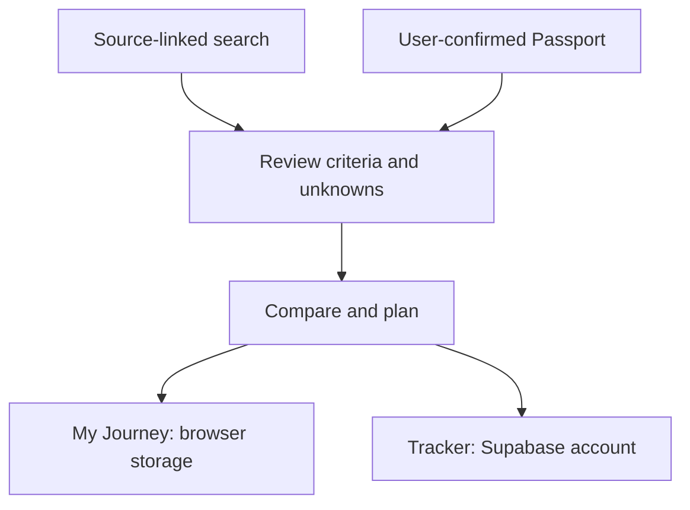

# Sourced

**Find an opportunity. See the evidence. Decide the next step.**

Built for the **Hong Kong AI Summit: BUILD ACROSS Hackathon**, Startup Track, **3–4 October 2026**. Sourced connects student opportunity search with a reviewed profile, comparison and application tracking.

[Architecture](docs/ARCHITECTURE.md) · [Local setup](docs/development.md) · [Search integration](docs/LIVE_SEARCH.md) · [Event](https://www.startmeup.hk/events-detail/hong-kong-ai-summit-build-across-hackathon/)



The two tracking flows are separate. Signing in does not migrate browser-local records.

## What I contributed

Hajar's work connects **discovery to follow-through**: dashboard search and goal starters, search controls, persistent three-item comparison, My Journey action plans, Opportunity Brief presentation and the browser-local affordability scenario editor. Responsive layouts, keyboard access and visible source/unknown states are part of that work.

Teammates owned CV extraction, retrieval/source-quality improvements and eligibility verification. The digital-finance teammate owned the pure calculator integration. These boundaries are reflected in the shared TypeScript contracts and adapters.

## Decisions that protect the user

- **Unknown stays unknown.** Missing eligibility criteria are not treated as satisfied. Eligibility is an interpretation of listed requirements, not an admission decision.
- **Evidence stays attached.** Live results retain the source URL and retrieval time. Fictional Browse fixtures are labelled and have no real application links.
- **Review comes before commitment.** Extracted profile suggestions need confirmation. Tasks and checklists never submit an application or change its status automatically.
- **Assumptions stay separate.** Affordability scenarios do not overwrite sourced funding facts or treat missing values as zero.

## Run the prototype

```sh
git clone https://github.com/hajarmrifag/opportunity-compass.git
cd opportunity-compass
npm install
npm run dev
```

Use Node.js and npm, then open the URL printed by Vite. Browser-local Journey and fictional Browse data provide a first look. Account features require Supabase; live search and extraction need server-side integrations.

```sh
npm run build
npm test
npm run lint
```

[Environment setup, repository map and data limits](docs/development.md) · [Current documentation](docs/README.md)

**Scope:** a hackathon prototype. Retrieved pages can be incomplete or stale; users must verify the original source. Clearing browser storage loses local Journey data unless it has been exported. Gmail scanning is unavailable in this branch.

The repository's earlier names were **Opportunity Compass / OpportunityOS**. The app is branded **Sourced**, built with [Lovable](https://lovable.dev).
